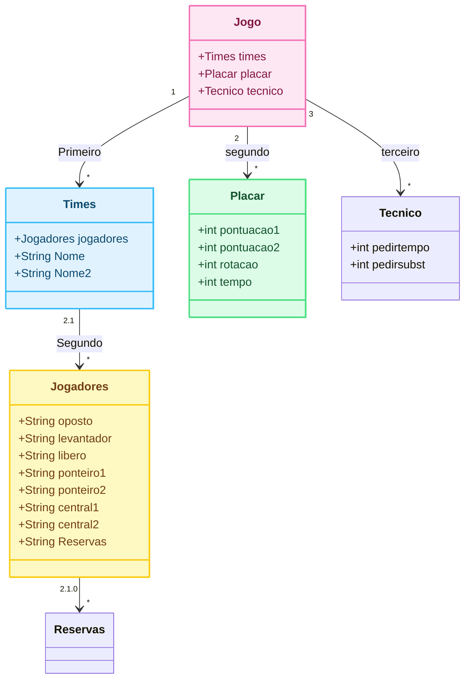

# Trabalho_avaliativo

## SIMULADOR DE TECNICO DE VOLEIBOL(Jogo simulado de volei, onde voce e o tecnico)

## Colaboradores

- [Martin](https://github.com/MartinSjr01)
- [Thomas](https://github.com/avilathomas)
- [Isabelle](https://github.com/bellemichielin)
- [Murilo](https://github.com/muriloeichholz)
